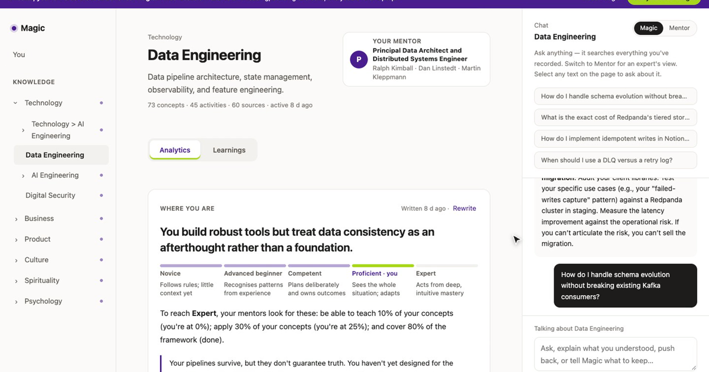
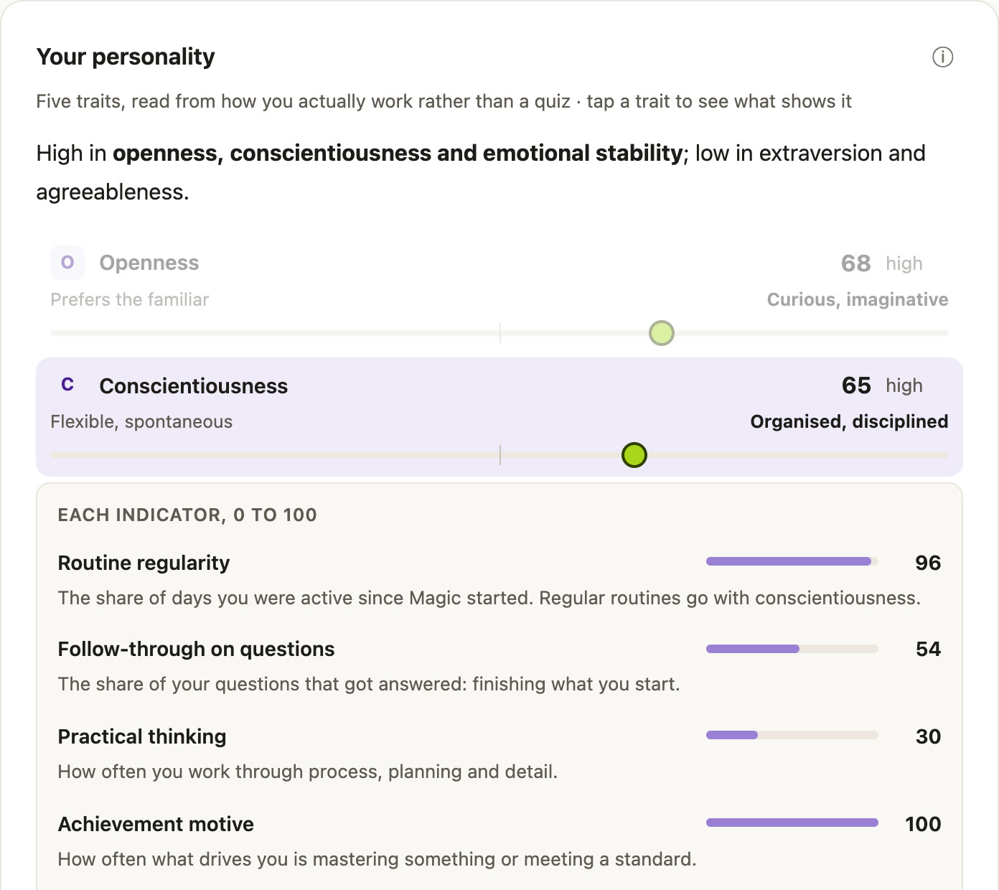
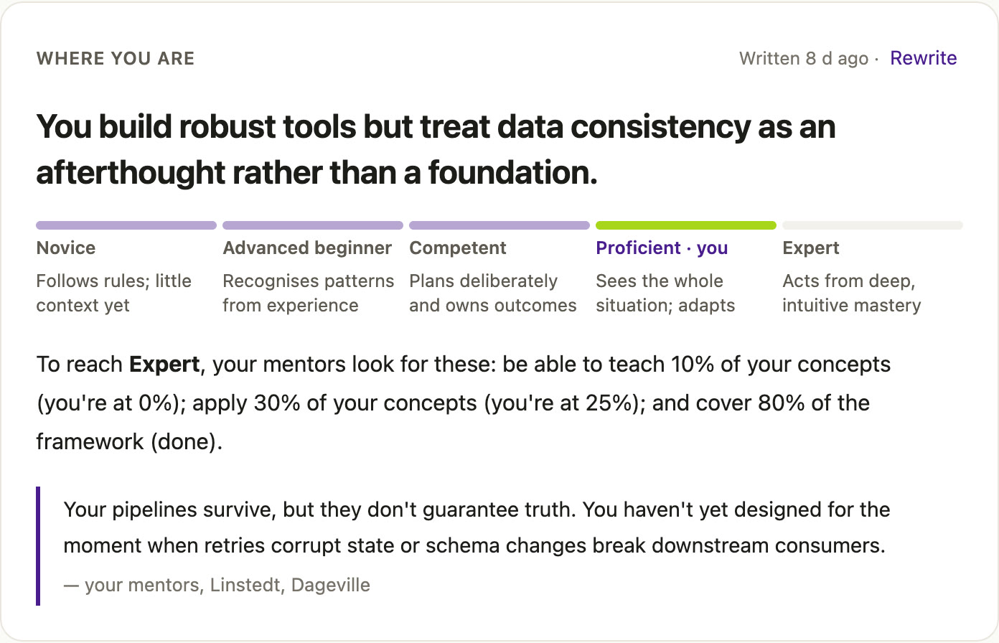
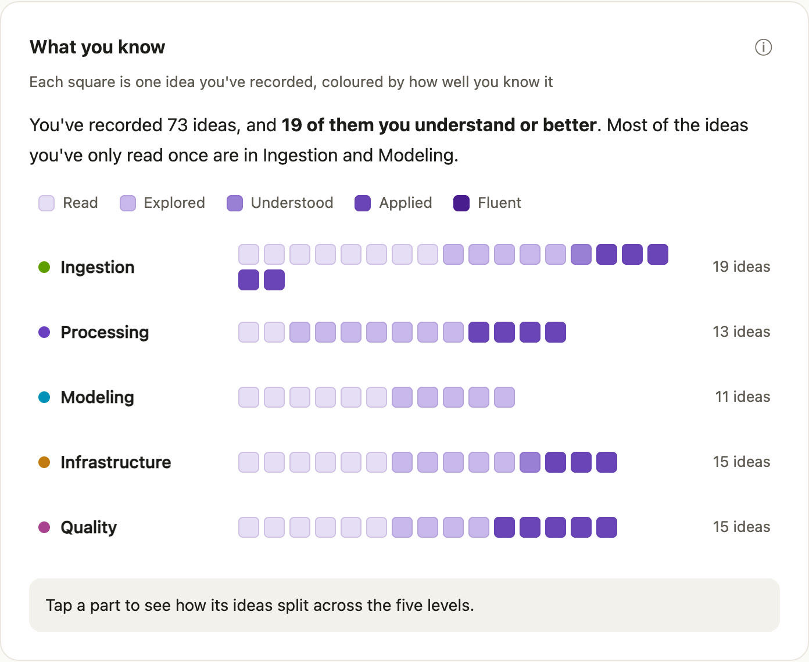
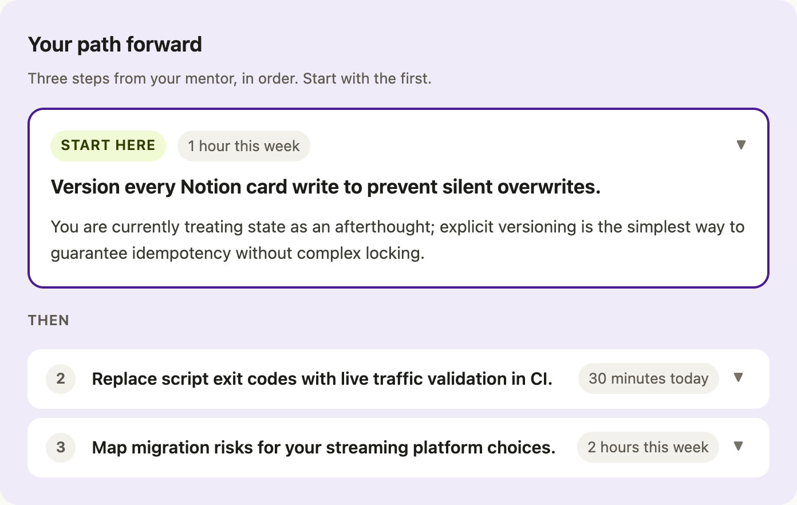

# Magic

**The personal context layer: a private AI that shows people who they're becoming and how to grow.**

## The problem

We live in dozens of apps, multitask all day, and now AI does whole tasks for us. Few of us can say where our time went, what we actually learned, or what to do next to grow. What we're becoming isn't visible to anyone, not even to us.

## What Magic does

Magic privately records what you do on your laptop (browser, apps, screen, calls), and on-device AI turns it into a living picture of you:

| | |
|---|---|
| 🧭 **Where you stand** | Skills graded from first read to applied, across every area of your work and life |
| 🧠 **How you think** | Personality and drives read from behaviour, not quizzes, with strengths and blind spots |
| 🪜 **What to do next** | One next step per area, plus mentors for each stage |
| 🔒 **Private by design** | Everything runs on your laptop: 0 bytes go to the cloud |

Screen and chat memory tools help you *remember*. Magic shows who you're *becoming*. Next, every AI agent can ask Magic for context, with your permission.

## Built and running today

| 20,429 | 988 | 27 | 0 bytes | 26 days |
|:---:|:---:|:---:|:---:|:---:|
| moments recorded | ideas mapped | topics | sent to the cloud | from first commit to live |

<table>
<tr>
<td width="50%"> <b>You</b>: who you are, read from behaviour</td>
<td width="50%"> <b>Where you stand</b>: skill depth per area</td>
</tr>
<tr>
<td width="50%"> <b>What you know</b>: every idea you've met, and how far you've taken it</td>
<td width="50%"> <b>Your path</b>: the next step and who to learn from</td>
</tr>
</table>

## What's in this repo

This is the public website and demo. The Magic app itself (the Rust recorder, on-device AI pipeline and knowledge graph) lives in a private repo, [psinglap/magic](https://github.com/psinglap/magic).

| Path | What it is |
|---|---|
| `index.html` | One-page pitch with the narrated product video |
| `about.html` | Founder page |
| `try.html` | Early-access list |
| `demo/` | Read-only copy of the Magic app, running on a redacted snapshot of the founder's real data |
| `api/` | Vercel functions that store early-access sign-ups privately in Vercel Blob |
| `media/` | Video, captions, screenshots |

To run it locally, serve the folder with any static server, for example `npx serve .`. To deploy it, run `vercel --prod`.

## Founder

I'm **Pallavi Singla**, a two-time founder. My first company, SchoolsOnWeb, was acquired by ImaginXP, and I then scaled ImaginXP to 1M+ students across 20,000 schools. Since then I've been a Senior Technical PM at AWS and a Senior PM at Snappr, and co-founded Mozie. I have an MBA from Berkeley Haas.

[LinkedIn](https://www.linkedin.com/in/p-singla/) · [pallavi.singla@berkeley.edu](mailto:pallavi.singla@berkeley.edu)

© 2026 Pallavi Singla. All rights reserved.
